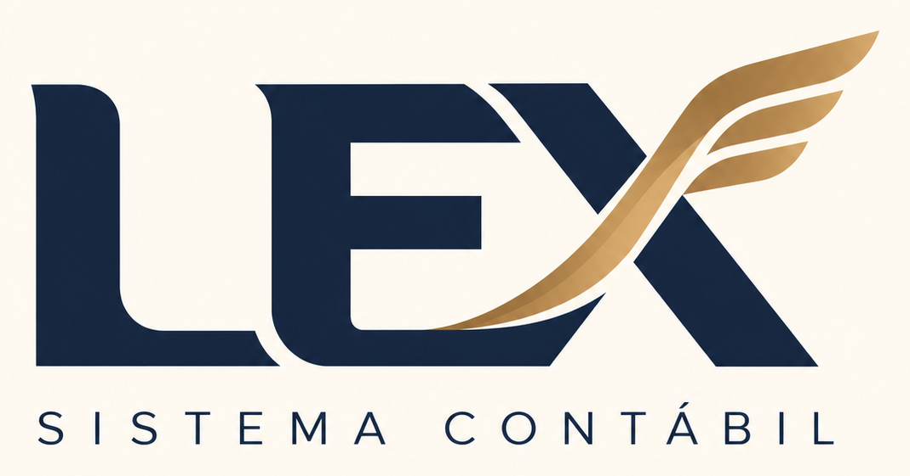
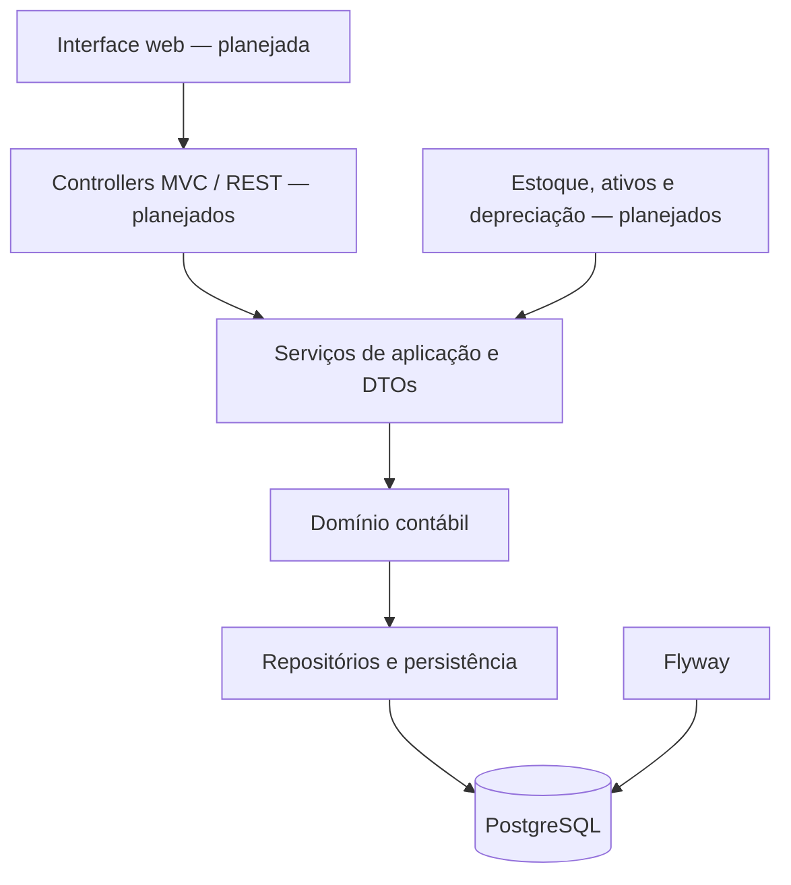

# LEX — Sistema Contábil



Sistema web de contabilidade educacional, desenvolvido para apoiar os alunos do curso técnico em Administração nas atividades de abertura empresarial, escrituração e interpretação das demonstrações contábeis.

**Em desenvolvimento · Entrega acadêmica prevista: 30/11/2026**

O LEX busca transformar operações empresariais em registros contábeis rastreáveis, mantendo a integridade dos dados e uma interface compreensível para usuários em formação. Não se apresenta como produto fiscal certificado ou substituto de assessoria contábil profissional.

## Comece por aqui

| Documento | Finalidade |
|---|---|
| [Requisitos acadêmicos](docs/requisitos-academicos.md) | Escopo da entrega |
| [Decisões e cronograma](docs/decisoes-e-cronograma.md) | Diretrizes e prioridades |
| [Andamento](docs/andamento.md) | Estado atualizado, checkpoints e pendências |
| [Integração web](docs/integracao-web.md) | Contratos HTTP preliminares e arquitetura proposta |
| [Guia frontend](docs/guia-frontend.md) | Divisão de trabalho, telas e critérios de integração |
| [Identidade visual](docs/identidade-visual.md) | Diretrizes da marca aprovada e implementação de interface |
| [Manual de identidade visual (PDF)](docs/Manual_Identidade_Visual_LEX.pdf) | Referência oficial da marca, versão acadêmica 1.0 |
| [AGENTS.md](AGENTS.md) | Orientações para desenvolvimento assistido por agentes |

## Funcionalidades

| Módulo | Estado em 27/11/2026, 00:07 (BRT) |
|---|---|
| Usuários e empresas | Persistência e titularidade existentes. Autenticação e gestão web pendentes |
| Plano de contas | Serviço de provisionamento do plano padrão validado. Consulta e gestão web pendentes |
| Lançamentos, partidas, confirmação e estorno | Serviços validados |
| Saldos iniciais e proteção temporal | Serviços validados |
| Livro Diário | Serviço validado |
| Livro Razão | Serviço por conta analítica validado; emissão integral pendente |
| Balancete, Balanço Patrimonial e DRE | Serviços validados |
| Fechamento mensal e anual, continuidade patrimonial | Núcleo validado; integração operacional pendente |
| Estoque PEPS, ativos e depreciação linear | Planejados |
| Auditoria | Estrutura persistente e eventos de fechamento; cobertura geral pendente |
| API REST, autenticação e interface | Planejadas; contratos preliminares documentados |
| PDFs, implantação pública e manual do usuário | Pendentes |

O último checkpoint de código validado é `597f34e`. A regressão de 27/11/2026 às 00:07:27 (UTC−03:00) terminou em 01:13 min com `BUILD SUCCESS` e **133 testes, zero falhas, erros ou ignorados**. O schema de testes está na V7. O 6D planejou 36 endpoints. Destes, 16 têm serviços de aplicação disponíveis e 20 dependem de implementação adicional. A camada HTTP permanece pendente. [Andamento](docs/andamento.md).

## Tecnologias e arquitetura

- Java 21, Spring Boot 4.1.2 conforme o `pom.xml`, Spring MVC e Spring Data JPA/Hibernate.
- PostgreSQL (18.4 no ambiente validado), Flyway e Maven Wrapper.
- JUnit e testes de integração em PostgreSQL isolado.
- Thymeleaf já consta no `pom.xml`. O 6D recomenda Thymeleaf, HTML5, CSS3 e JavaScript com Spring MVC, API REST e sessão no servidor na mesma origem HTTPS, em um único JAR. A escolha será alinhada com o colaborador frontend. React + TypeScript foi avaliado como alternativa.

O sistema é organizado em camadas, com regras de negócio no servidor. A apresentação não deve acessar repositórios nem recriar cálculos contábeis autoritativos.



### Estrutura do repositório

Recorte dos caminhos existentes ou incluídos neste conjunto documental.

```text
lex/
├── AGENTS.md
├── README.md
├── pom.xml
├── mvnw / mvnw.cmd
├── docs/
├── scripts/
│   └── test.ps1
└── src/
    ├── main/
    │   ├── java/br/com/lex/
    │   │   ├── LexApplication.java
    │   │   ├── application/contabil/
    │   │   │   ├── dto/
    │   │   │   └── service/
    │   │   └── domain/contabil/
    │   │       ├── entity/
    │   │       ├── enums/
    │   │       └── repository/
    │   └── resources/
    │       ├── application.yaml
    │       └── db/migration/  # V1–V7
    └── test/
        ├── java/br/com/lex/
        └── resources/application-test.yaml
```

Os diretórios locais `src/main/resources/templates/` e `src/main/resources/static/` estão vazios e não têm arquivos versionados. O 6D propõe usá-los para templates e recursos da interface.

## Identidade visual

A marca LEX remete ao latim *lex* (lei). A identidade aprovada combina azul-marinho `#1C2842`, creme `#FAF4EA` e dourado `#B58A4A`, com Inter como fonte funcional preferencial e DM Serif Display ou Libre Baskerville para destaques editoriais. A imagem acima é a arte raster aprovada, extraída sem redesenho do manual; a matriz vetorial final permanece pendente. Consulte o [manual original](docs/Manual_Identidade_Visual_LEX.pdf) e as [diretrizes de implementação](docs/identidade-visual.md).

## Ambiente local

Para iniciar localmente, usar Git, JDK 21, PostgreSQL e Maven Wrapper do repositório. O script de testes requer PowerShell. Cada colaborador usa seus próprios bancos e credenciais locais.

```powershell
git clone https://github.com/HsFenrir/lex.git
cd lex
java -version
.\mvnw.cmd -v
```

Provisionar um banco de desenvolvimento `lex_dev` e um banco de testes `lex_test` com papéis distintos. O papel de testes `lex_test_runner` não deve possuir CONNECT no banco de desenvolvimento, inclusive por permissões herdadas de PUBLIC. Solicitar ao responsável a configuração de provisionamento antes de executar a suíte.

Configuração de desenvolvimento (`DB_URL` tem fallback local conforme configuração conhecida; explicitar é preferível):

| Variável | Exemplo / finalidade |
|---|---|
| `DB_URL` | `jdbc:postgresql://localhost:5432/lex_dev` |
| `DB_USERNAME` | Papel local de desenvolvimento |
| `DB_PASSWORD` | Segredo local; configurar no ambiente ou IDE |
| `TEST_DB_URL`, `TEST_DB_USERNAME`, `TEST_DB_PASSWORD` | Configuração exclusiva do perfil de testes, preparada pelo script |

```powershell
.\mvnw.cmd spring-boot:run
```

O comando pressupõe banco provisionado e variáveis configuradas. A inicialização do servidor não significa que a interface ou os endpoints já estejam disponíveis. Não executar migrations em bancos compartilhados sem autorização.

### Testes

```powershell
.\scripts\test.ps1
```

Executar em uma sessão PowerShell dedicada. O script solicita a senha de `lex_test_runner` e usa `psql` para verificar `lex_test` em `127.0.0.1:5432`, a identidade da role e a ausência de privilégio `CONNECT` em `lex_dev`. Ele configura e limpa as variáveis de teste. O Maven roda em modo offline por padrão. Use `-Online` quando for necessário obter dependências. [Ambiente de execução](docs/andamento.md#4-ambiente-de-execução).

## Regras de desenvolvimento

- Implementar em incrementos pequenos, revisar diffs e executar a suíte relevante antes de integrar alterações de código.
- Não editar migrations já aplicadas; criar a próxima migration incremental.
- Preservar isolamento por empresa, transações, constraints e bloqueios existentes.
- Usar `BigDecimal` e preservar precisão monetária; o frontend não é fonte de verdade para saldos.
- Lançamentos confirmados não são editáveis. Estornos preservam original e reversão nas datas contábeis próprias.
- Rascunhos não integram os livros; operações em períodos fechados e anteriores à abertura de migração são bloqueadas conforme regras do servidor.
- Os módulos operacionais devem utilizar o núcleo de escrituração em transações coerentes, sem contabilização paralela.
- Não publicar segredos, dados reais de usuários, logs sensíveis ou configurações privadas da IDE.

## Colaboração

Sincronize a branch principal e crie uma branch de trabalho (por exemplo, `feat/frontend-base`). Combine previamente alterações em contratos HTTP, DTOs, segurança e arquivos compartilhados. Prefira commits focados e revisão antes da integração na `main`. Não faça force push ou alterações destrutivas sem autorização.

O frontend pode evoluir com fixtures fictícias explicitamente marcadas, enquanto a API é implementada. Não apresentar mocks como dados persistidos nem inventar endpoints definitivos. Consulte o [guia frontend](docs/guia-frontend.md) antes de começar.

## Entrega acadêmica

A entrega deverá incluir link funcional, manual de utilização e demonstração dos fluxos obrigatórios. Hospedagem, endereço público e licença de distribuição ainda não estão definidos nesta documentação. Não presumir que o código possui licença de software livre na ausência de arquivo de licença aprovado.
