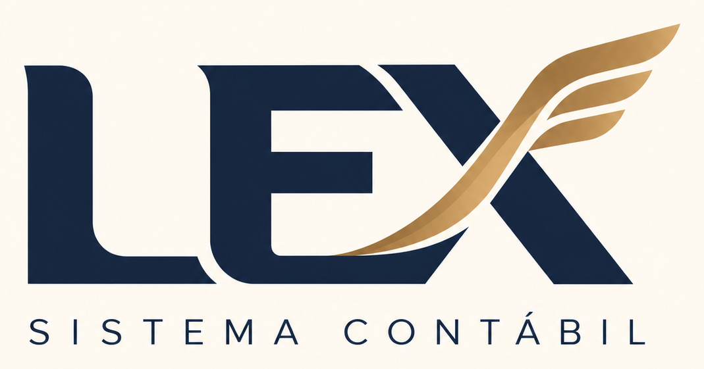

# LEX — Identidade visual e diretrizes de interface

O manual é a referência normativa da identidade visual, na versão acadêmica 1.0 de outubro de 2026, com 11 páginas. Este documento traduz suas especificações para a web e identifica as extensões propostas para implementação. [Manual de Identidade Visual LEX](Manual_Identidade_Visual_LEX.pdf).

## Estratégia e assinatura

LEX remete ao latim *lex* (lei), à estrutura normativa, coerência e responsabilidade. A identidade comunica clareza operacional, rigor e confiança, com distintividade, redução, coerência e versatilidade. O lettering serifado é protagonista; o gesto dourado sugere movimento e ascensão, as três terminações evocam asas de Mercúrio e as formas inferiores remetem abstratamente aos pratos de uma balança.



Arte raster original extraída da página 3, com 1069 × 561 px, em RGB sem transparência. Usar a versão principal sobre creme. As versões monocromática e negativa das páginas 7–8 são estudos a conferir e vetorizar antes do uso oficial. Preservar o lettering e as proporções originais da arte. Manter área de proteção de pelo menos 0,5 vez a altura do E em todos os lados. A largura mínima recomendada para a assinatura completa é de 180 px no digital e 35 mm na impressão. Permanecem pendentes a matriz vetorial, o PNG transparente, as versões finais monocromática e negativa e o favicon simplificado para 16–32 px (pp. 3–4, 7–10).

## Paleta oficial (p. 5)

| Token sugerido | Cor oficial | Hex | Uso |
|---|---|---|---|
| `--lex-primary` | Azul LEX | `#1C2842` | Navegação, cabeçalhos, orientação |
| `--lex-bg` | Creme LEX | `#FAF4EA` | Fundo principal |
| `--lex-accent` | Dourado | `#B58A4A` | Acentos, detalhes e destaques pontuais |
| `--lex-text` | Grafite | `#202A3A` | Texto auxiliar e interfaces |
| `--lex-muted` | Cinza neutro | `#697386` | Metadados e textos secundários |

Proporção indicativa: 60% creme, 30% azul-marinho, 10% dourado. Não é obrigação matemática. Usar azul-marinho ou grafite em textos sobre superfícies claras. Não usar dourado como texto corrido sobre creme. Validar contraste real, inclusive do cinza neutro; não comunicar estados apenas por cor.

## Tipografia oficial (p. 6)

- Interface e documentos: Inter (preferencial) ou Source Sans 3.
- Destaques editoriais, capas e chamadas institucionais: DM Serif Display ou Libre Baskerville.
- No máximo duas famílias na mesma peça; não usar fontes para reconstruir o lettering.

| Nível | Escala |
|---|---|
| H1 | 28–36 px, Semibold/Bold |
| H2 | 20–24 px, Semibold |
| Corpo | 14–16 px, Regular |
| Dados/tabelas | 13–14 px, Regular, números à direita |
| Legenda | 12 px, Regular |

## Aplicações (pp. 9–10)

Navegação principal e cabeçalhos em azul-marinho; formulários e tabelas claros, com divisórias discretas e boa densidade. Dourado reservado a destaques pontuais. Relatórios com marca no cabeçalho ou capa, títulos em azul-marinho, texto grafite e corpo neutro, legível em escala de cinza. Apresentações com fundo creme, títulos azul-marinho e pequenos acentos dourados. Evitar marcas d’água excessivas e efeitos metálicos simulados.

## Extensões técnicas propostas para frontend

Os itens desta seção não constam como especificações oficiais do manual: são recomendações para implementação, sujeitas à validação do responsável.

```css
:root {
  --lex-primary: #1C2842;
  --lex-bg: #FAF4EA;
  --lex-accent: #B58A4A;
  --lex-text: #202A3A;
  --lex-muted: #697386;
  /* Extensões funcionais propostas, não cores oficiais da marca */
  --lex-surface: #FFFFFF;
  --lex-border: #CBD5E1;
  --lex-control-border: #64748B;
  --lex-success: #166534;
  --lex-warning: #92400E;
  --lex-danger: #B91C1C;
  --lex-focus: #2563EB;
  --lex-font: "Inter", system-ui, sans-serif;
  --lex-font-display: "DM Serif Display", Georgia, serif;
  --lex-radius: 8px;
}
```

Centralizar tokens em CSS compartilhado. Proposta: espaçamento de 4, 8, 12, 16, 24 e 32 px; navegação lateral recolhível em telas pequenas; cabeçalho com empresa, exercício e período; campos com rótulos persistentes; tabelas com cabeçalhos semânticos, hierarquia por recuo e totais sem duplicidade. Exibir rascunho, confirmado, estornado e período encerrado com texto explícito. Prever carregamento, vazio, erro, sucesso e acesso negado. Usar números tabulares e alinhados à direita; moeda `R$ 1.234,56` e datas `dd/mm/aaaa` na apresentação. Não associar débito a prejuízo ou crédito a lucro.

Meta proposta de acessibilidade: WCAG 2.2 AA, sem declaração de conformidade antes de testes. Verificar contraste (4,5:1 para texto normal; 3:1 para texto grande e componentes pertinentes), teclado, foco visível, rótulos, mensagens, zoom e reflow. Preferir texto azul-marinho ou grafite sobre dourado quando usado em controles, após verificar contraste. Não usar cores semânticas como única indicação de estado. Fontes devem ser obtidas de fontes legítimas, com licenças verificadas; nenhum arquivo de fonte acompanha este pacote.

## Checklist de publicação

Verificar legibilidade do nome, proporção, área de proteção, contraste, uso pontual do dourado, adequação da versão ao tamanho e ao fundo e revisão em tela e impressão. A aprovação da identidade não equivale à aprovação de uma matriz vetorial ou de uma interface já implementada.
